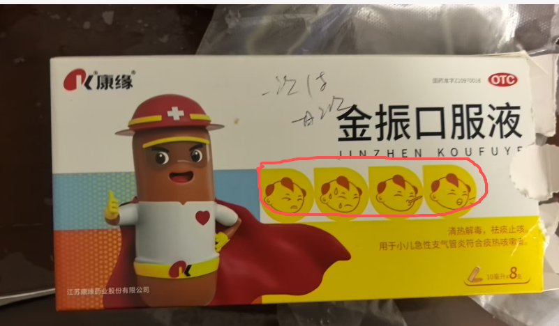

国庆回老家，小孩子感冒流鼻涕，没多想就带到妇幼，旧的妇幼关门的，新的妇幼好不容易找到，规模扩大了不少倍，那个年轻的男中医急着下班，慌忙之间开的两盒感冒药，吃完发现情况不可收拾，从刚开始的间歇性咳嗽 变成了咳的缓不过气来，鼻涕流成河，老婆水药 没吃够，就逼我去药店买同款，刚出药店门看了下配料表，他妈有川贝，流的清鼻涕 他妈的开川贝，就回到药店退了45块钱，还被药店数落半天，说今天要不是一号 是不给退的，回到家 给小孩洗了两天艾叶水澡 基本痊愈。我在想其实这么简单的问题 我稍加用心都会， 他未必不会，他或许身兼着其他不可描述的任务，就像这感冒药里四个鬼子造型一样。

