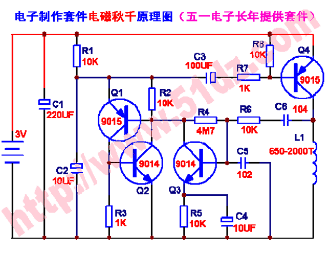
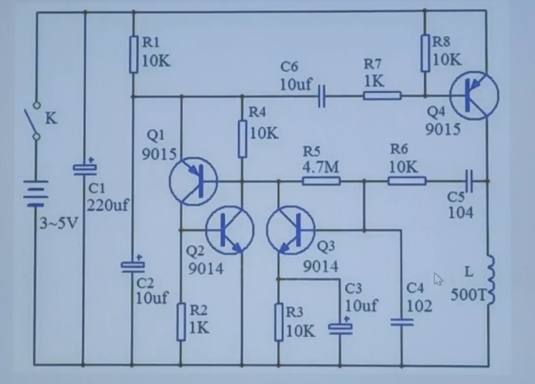
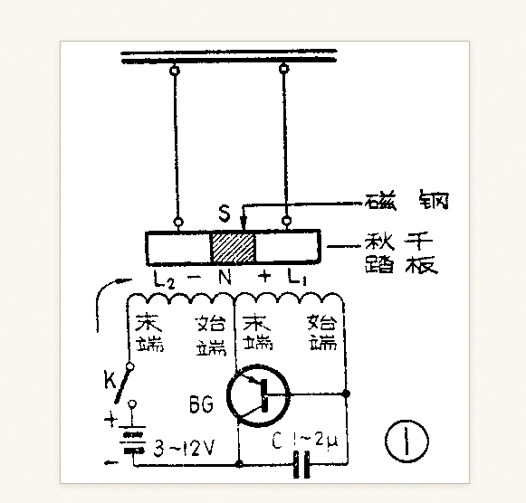
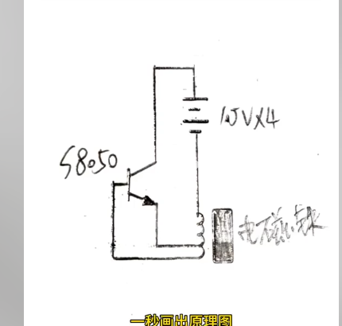

特点介绍： 
本电路由本站自行设计，设计新颖独特，每一个元件都有它自己的作用，各元件的功能
明确，结合巧妙，互相搭配，互相影响，搞懂了本电路，相信对三极管的作用、功能、
应用都会有一个更深层次的理解，可以这么说，搞懂了这个电路，电路、电容、三极管
这块基本上就可以毕业了，因此，对于学校老师来说，本电路是非常好的、电子元件应
用的一个教程！欢迎学校老师批量购买。本电路还有另一个优点，工作电流小，效率高，
元件装错也不会损坏电子元件。 
原理简介： 
本电路中Q3为低功耗、高增益放大器，相对于Q3来说，通过R1供电，C2为滤波电容，
Q3 为共发射极放大电路，R2为集电极负载电阻，R4提供基极电流，R5稳定流工作点，
C4 为交流旁路电容，这样，Q3大约会有0.1-0.2MA的工作电流，工作在放大状态，C5为
高频滤波电容，消除L1较长的引线带来的干扰信号，R6和C6为信号输入，C6为隔直电
容。 
当L1感应到磁铁经过时，会感应出几微伏的电压信号，该信号是一个周期的低频交
流信号，改变磁铁的南北极或者交换L1的两端接线，使负半周先出现，当负半周时，Q3
集电极电压上升，当负半周结束时，这时磁铁已经荡过线圈的中心位置，信号进入正半
周，这时Q3基极电压升高，Q3集电极电压下降，这时Q1会产生较大的基极电流，从面
会产生更大的集电极电流，该集电极电流经过R3产生远远高于0.6V的压降，从而Q2也
进入导通状态。 
这里Q1和Q2构成的实际上是一个可控硅电路，Q2导通会加剧Q1导通，Q1导通会
加剧Q2导通，这是一个强烈的正反馈过程，在一瞬间，Q1、Q2完全导通，C2电压会急
速下降，同时，由C3两端的电压不能突变，C3会立即经过R7、R8充电，由于R8大于
R7，这会给Q4产生基极电流，Q4导流，L1线圈得电产生电流，该电流正好是产生排斥
磁铁的力，相当于在最合适的时候，推了一下秋千。 
Q1、Q2 组成的可控硅电路导通，C3也充电充满了，C2也因为放电两端电压大幅下
降，Q3也退出放大状态了，之后的电流来源只剩下R1供电了，但是R1电阻较大，最大
供电电流也会小于0.5MA，这样就使得C2两不能在R3上产生大于0.6V的压降，Q2会没
有基极电流，集电极电流也会变成没有，Q1也会跟着截止，C3充电也结束，Q4没了基极
电流也会截止，最后的结果就是所有的三极管都会截止，这时R1会给C2充电，C2两端
电压会上升，C3会通过R7、R8、R1放电，C3两端电压会下降，当C2电压上升到一定值
时，Q3又会进入放大状态，等待秋千的下一次经过。 
因此，本电路工作时，没有秋千经过时，只有Q3工作在微电流放大（工作电流小于
0.1MA）状态（Q1也可能会产生一点点的电流），但是总的静态工作电流已经由R1限制
在0.1MA 左右，即使电源电压上升到6V时，整机的静态电流也小于0.5MA，所以，本电
路非常省电。另外，Q4平常一直都是工作在零偏置，处于截止状态，仅仅只在最需要推
秋千的瞬间才给L1供电推动秋千，因此，本电路的工作效率极高！如果要减少推力，可
以在L1上串联电阻，限制经过L1的电流。 
本电路设计巧妙之处在于： 
1、本秋千突破传统，发扬传统，只用一只线圈既作秋千检测线圈，又做推力输出线圈； 
2、Q4 采用零偏置给线圈L1供电，给L1供电的大小和时间都可以在一定范围调节； 
3、Q3 采用微功耗加负反馈来放大L1的检测秋千到来的信号； 
4、为了达到第一条优点，Q3采用失去供电的方法来克服Q4给L1供电产生的巨大干扰信
号； 
5、Q1、Q2 组成可控硅电路，在Q3检测到秋千后，给Q3失电截止，让Q4通电给L1供电。 
6、Q4 推动秋千后，Q1、Q2会自动截上，Q3会自动进入放大等待下一次运行。 
本电路中，R7也有一定的作用，它可以限制Q4的基极电流不要太大，同时延长Q4
给线圈的供电时间，这适合机械结构比较差的电磁秋千，因此，本电磁秋千电路适合绝
大多数高速的、低速的、大线圈的、小线圈的、大体积的、小体积的各种各样的电磁秋
千应用！本电路设计版权所有，禁止竟争对手仿制！请注意：电磁秋千最终能否制作成
功，某种程度上还取决于用户的机械装置！如果用户的机械装置不合理，那也可能不成
功。但是，机械的问题毕竟比较简单，是眼睛看得见的问题，是用手就模得着的问题，
本站不加以深入讨论，本站的电磁秋千套件，会提供一个简易的机械装置，确保用户的
秋千绝对能荡起来！（再请注意：本秋千在启动时必须先人为的启动，如果秋千速度太
低，或者磁铁距离线圈太远，导致L1连几毫伏的电信号也无法产生，本秋千就不会荡起
来。） 
另外，本套件配套的电路板，板上有两套对称的安装位置，请注意，只要安装一边，
但是如果你自己有元件，自己设计了外壳，你完全可以另外装多一套电磁秋千！ 
还有，本套件配的旋转支架，实际上也就是本站的LED旋转点阵用的电路板连接器，
不过，本支架多钻了一个0.9MM的孔，但是，这仍然不影响大家以后做LED旋转点阵时
做电路板连接器。 
还有，大家在安装时要注意，套件中有一个螺丝固定弹簧，通过旋转螺丝就可以调
节螺丝到经圈的距离，这非常方便，但是请用工具旋转，不要用手直接旋转，小心手的
安全，不要让螺丝和弹簧刺伤了手，我们实在是不希望大家收到血的教训。如果有人因
为本站电子制作而受伤，我们会感到非常难过，但是我们不会同情，也不会承担任何责
任，请谅解！ 
 最后，祝愿大家顺利！ 
装配步骤： 
第一部分：电磁秋千电路板组装 
对照电路原理图，电路板图，任选一边开始安装全部的电子元件，最后焊上线圈，
并通电测量电路是否工作正常，静态工作电流一般为0.2MA，这时，用磁铁划过线圈，电
流会瞬间变大，并立即减小，这说明电路板组装成功了。请注意：电流会瞬间变大，具
体是多大，我们是没法测量的，理论上也不会有很大，因为线圈有内阻，即便是短路电
流也小于300MA。我们可以通过改变C3的电容量和R7的电阻值来调节经过线圈的电流和
时间，这一般在最后硬件组装调试时配合进行。 
第二部分：电磁秋千支架组装 
先将铜柱通和铜柱接对接，然后一头用螺丝固定在线路板，另一头用螺丝将支点钢
针固定，让钢针伸向没有装元件的一方，电磁线圈也将固定在钢针的正下方。 
再将4*30的平头螺丝拧进螺丝固定簧，将磁铁放在平头螺丝，强力磁铁会自动的紧
紧吸住，再用螺丝固定在旋转支架上，再将支架和钢针套上，调整螺丝和电路板上电磁
线圈的距离，让磁铁和线圈有1mm左右的距离（距离越近越省电，越容易成功），并且
确保磁铁能自由荡过线图上方又不碰到线圈，再用限位胶通套上钢针端部，确保旋转支
架组件（包含平头螺丝和磁铁）不在钢针上前后移动，但是又能自由转动。 
再水平放置电路板，必要时在电路板四角贴上四个2mm高的脚，让电路水平不要摇
动，然后将电磁线圈固定在磁铁的正下方，这时，用手拨动磁铁支架，可以自由的转动
做阻尼运动，这时，电路部分和机械部分都组装完毕。 
第三部分：通电调试，加装负载 
给主板接上3V电源通电，用尖嘴夹子短路Q4的CE极，观查磁铁的运动情况，如果
磁铁向线圈外边跑，表明磁铁极性是正确的，否则，将磁铁转一面后放置。这时，用手
推动一下磁铁，秋千就应该荡起来了。因为元器件的差别，如果觉得推力不够，或者不
能荡起来（会自动停止），请减小R7的阻值和增大C3的电容量。 
一般来说，秋千装好后，我们一般还会给秋千加上负载，如动画中显示，我们增加
了一个名片，我们要让名片不停的摇下去，但是，随着支架质量的改变，秋千的荡动的
频率也会改变，秋千的负载也在改变，我们都可以通过调节R7的阻值和C3的电容量让
最小的电源电流来推动负载。 
最后，我们祝愿大家制作出自己满意的电磁秋千作品。
